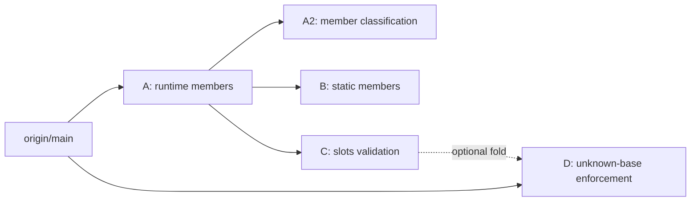

# Protocol 运行时检查：评审记录与拆分计划

## 1. 分支地图

| 分支 | 用途 | 状态 |
|---|---|---|
| `council/protocol-fixes` | 总分支：完整参考实现（A+A2+B+C+D）、评审记录、后续 PR 计划 | 当前分支；代码 HEAD `6058f9cd8`，本计划在其上追加 |
| `fix/protocol-runtime-members` | 第一个 PR，A：CPython 运行时成员集 | 基于 `origin/main` `71b6c5009`，提交 `223a4c8bd` |
| `fix/protocol-member-classification`（建议） | A2：按声明分类协议数据成员 | 待建，基于 A 或合并后的 `main` |
| `fix/protocol-static-members`（建议） | B：静态成员集切到 mypy 的表 | 待建，基于 A 或 `main` |
| `fix/slots-declaration-validation`（建议） | C：`__slots__` 字面量与元素类型校验 | 待建，基于 A 或 `main` |
| `fix/slots-unknown-base`（建议） | D：未知布局时关闭 slot 检查 | 待建，基于 `main` |

参考材料：

- `protocol-slots-issubclass-false-positive.md`：826 行设计说明，记录完整证据、版本矩阵和已知缺口。它是本地背景材料，不进入任何 PR。
- `false-positive-bug.md`：原始误报报告。
- 本文档合并了此前三份 council memo 和 commit-message 文档；后续以本文档为准。

## 2. 结论

**真实问题成立，核心修复正确，但不能作为一个 PR 合并。**

- 上游 issue [meta/pyrefly#5614](https://github.com/meta/pyrefly/issues/5614) 的 `issubclass()` 误报已修复：`__slots__ = ()`、`typing.SupportsInt`、`collections.abc.Buffer` 不再报 `invalid-argument`；非空 slot 和普通数据成员仍然报错。
- `members` / `runtime_members` / `has_data_slots` 三字段模型是正确的长期形状：静态成员跟随 mypy，运行时成员跟随 CPython 的逐版本排除表。后续的 MRO 类值查找可以替换 `member_is_callable` 和 `has_data_slots`，不需要改集合。
- 当前完整分支把四个独立行为变化塞在一起，生产代码 +312/−45，超过 `CONTRIBUTING.md` 的约 150 行非测试代码建议，而且没有 `mypy_primer`。
- 拆成 A/A2/B/C/D 后，A 单独关闭 #5614，生产代码 +134/−13，回到门槛以内。

## 3. 问题与运行时事实

报告的最小复现：

```python
from abc import abstractmethod
from typing import Protocol, runtime_checkable

@runtime_checkable
class BufferProtocol(Protocol):
    __slots__ = ()

    @abstractmethod
    def __buffer__(self, flags: int, /) -> memoryview: ...

issubclass(bytes, BufferProtocol)
```

CPython 3.15 的运行时行为：

- `BufferProtocol.__protocol_attrs__ == {'__buffer__'}`；
- `BufferProtocol.__non_callable_proto_members__ == set()`；
- `issubclass(bytes, BufferProtocol)` 成功。

Pyrefly `main` 报：

```text
Protocol `BufferProtocol` has non-method members and cannot be used with issubclass() [invalid-argument]
```

同样的误报出现在 `typing.SupportsInt`、`collections.abc.Buffer`，以及所有在协议体里写 `__slots__ = ()` 的用户代码上。

根因：`ProtocolMetadata.members` 同时承担“静态结构化子类型的成员集”和“运行时 `isinstance`/`issubclass` 检查的成员集”。`__slots__` 是普通类字段，进入 `members`；`subset.rs` 早已跳过它，三个消费者对同一个集合的理解不一致。

## 4. 模型

`ProtocolMetadata` 的三个字段回答三个问题：

| 字段 | 来源 | 消费者 | 回答的问题 |
|---|---|---|---|
| `members` | 类体字段（A 中保持 main 的行为） | `type_order::get_protocol_member_names` → `subset.rs` | 实现类为了结构化赋值必须声明哪些名字 |
| `runtime_members` | 类体字段减去 CPython 运行时排除名，加上未被排除的 slot 名，继承合并 | `special_calls.rs` 的数据协议和 unsafe-overlap 检查 | 运行时协议检查会看哪些名字 |
| `has_data_slots` | 本类或继承的协议基类是否声明了至少一个通过运行时过滤的 slot 名 | `is_data_protocol` | 声明本身是否证明了数据属性 |

`runtime_members` 永不含字面 `__slots__`。非空且名字未被排除的 slot 声明会把名字加入 `runtime_members`，并置 `has_data_slots`；空声明、annotation-only、无法解析的声明都不置位。

`has_data_slots` 不能由 `runtime_members` 推导：slot 名可能解析到继承的可调用属性，成员类型会说“callable”，但 slot 描述符本身不是 callable。

unsafe-overlap 循环同时使用两个集合：遍历 `runtime_members` 做存在性检查，但只对 `members` 里的名字比较类型。slot-only 名是 presence-only，不会产生幽灵类型冲突。

运行时排除规则：

- 16 个在 3.8–3.15 都排除的稳定名字；
- `_abc_*` 前缀在所有版本跳过；
- `__class_getitem__` 从 3.9 起排除；
- `__match_args__` 从 3.13 起排除；
- `__annotate__` / `__annotate_func__` / `__annotations_cache__` 从 3.14 起排除。

运行时注入的名字（`__static_attributes__`、`__non_callable_proto_members__`、`__final__` 等）不做版本门控；显式写入这类名字的残余误报被接受。

### A 的行为契约

删除的 `invalid-argument`：

- 空 `__slots__`；
- 全被运行时过滤的 slot 名，如 `("__dict__",)`、`("__weakref__",)`；
- 显式写的 `__doc__`、`__module__`、`__annotations__`、`__dict__`、`__abstractmethods__`、`__subclasshook__`、`__weakref__`；
- `_abc_*`；
- 版本门控名在对应版本上；
- `SupportsInt`、`Buffer` 等 typeshed 协议；
- 无法静态解析的 `__slots__`（接受的假阴性）。

保留的 `invalid-argument`：

- 非空且至少一个名字未被排除的 slot；
- 普通数据成员；
- 空 slot 加数据成员；
- 从基协议继承的数据 slot。

新增的 `unsafe_overlap`：

- 带 `__slots__` 的协议，旧循环会先卡在 `__slots__` 的存在性检查上；A 改用 `runtime_members` 后，真正的成员类型冲突会报出来。

删除的 `unsafe_overlap`：

- `main` 会把协议和实现的 `__slots__` 类属性本身拿去做类型比较，产生幽灵 overlap；A 的运行时集不含 `__slots__`，幽灵消失。

## 5. 评审过程

没有 `council-*` profile，按 council skill 回退为 `oracle`（fork context）和 `reviewer`（fresh context）。两轮，Pass 3 未运行。

| 轮次 | Advisor | Run id | 结论 |
|---|---|---|---|
| 1 | oracle | `fedd148f-5169-4cec-b624-b783829fce02` | 核心正确；拆 A/B/C/D；A2 作为 owner decision |
| 1 | reviewer | `6a2a7145-61db-4dd8-8284-310e96e9c28f` | 核心正确；拆 A/B/C；分类器并入 A |
| 2 | oracle | `8cc0107a-06d8-489d-83b4-2054445c6056` | 改变立场：A 可复用旧提取器，A2 必须独立 |
| 2 | reviewer | `4153b547-f84c-4f01-b15e-6e8bbe63cd6a` | 改变立场：四段式 A/A2/B/C；A 约 90–140 行 |

Workflow：Pass 1 `9581b72f-add8-4212-9ed8-8daeb9d2e3cd`，Pass 2 `4bff1a1b-6cf5-4560-a281-6a67bc27f9b8`。两轮各 2/2 完成。

Pass 2 收敛的核心判断：

- A 不需要 `ClassField` 分类器，也不需要 `__slots__` 校验；复用分支前的 `explicit_slots` 提取器和旧的 `type_of_attr_get` 循环即可关闭 #5614。
- A2 是独立的行为变化：property 返回 callable 在旧循环里被当成方法，嵌套类、类对象、可调用实例被当成数据；这两类误报与 #5614 无关，且把 A 推到 165–200 行。
- B、C、D 各自改变报错集合，必须各自有 `mypy_primer`。
- A 的 primer 不能只写“删除了 `invalid-argument`”：unsafe-overlap 的存在性检查也变了。
- 设计说明的协议测试数 148 是过期数字，实际是 125；`member_is_callable` 的 `None` 分支是防御性的，不是死代码。

## 6. 已完成：PR A

分支 `fix/protocol-runtime-members`，提交 `223a4c8bd`，基于 `origin/main` `71b6c5009`。

```text
Use the CPython runtime member set for protocol checks

A runtime-checkable protocol declaring `__slots__ = ()` was classified as
a data protocol, so `issubclass(bytes, BufferProtocol)` and
`issubclass(int, SupportsInt)` reported `invalid-argument` even though
CPython accepts both. The same happened for typeshed protocols such as
`typing.SupportsInt` and `collections.abc.Buffer`, reported in #5614.

`ProtocolMetadata.members` answered two questions at once: what structural
subtyping requires, and what the runtime protocol check inspects.
`__slots__` is an ordinary class-body field, so it entered `members`; the
protocol subsetting code already skipped it, which is why the consumers
disagreed.

Add `runtime_members`, built from the class-body fields minus the names
CPython's `typing._get_protocol_attrs` excludes, plus the slot names that
survive the same filter. `has_data_slots` records whether the declaration
proves a data attribute, because a slot name can resolve to an inherited
callable and the member type alone cannot decide it.

`is_data_protocol` and the unsafe-overlap presence check now read
`runtime_members`. The overlap check compares types only for names in
`members`: a slot-only name is part of the runtime contract but has no
protocol-side type to compare. `_abc_*` is skipped by prefix, and
`__class_getitem__` (3.9+), `__match_args__` (3.13+), and the `__annotate__`
family (3.14+) are gated to match the CPython versions that exclude them.
Inheritance merges both sets and the flag from protocol bases.

An unresolvable `__slots__` value is treated as non-data. The runtime may
reject the `issubclass()` call, but the checker cannot prove it; this is a
deliberate false negative.

Tests cover empty, non-empty, excluded, and inherited slots; string and
annotation-only declarations; typeshed protocols; the version boundaries;
and the unsafe-overlap presence rule.
```

改动 4 个文件，+647/−13：生产代码 +134/−13，测试 +526。

| 文件 | 内容 |
|---|---|
| `pyrefly/lib/alt/types/class_metadata.rs` | `runtime_members`、`has_data_slots` 字段与文档 |
| `pyrefly/lib/alt/class/class_metadata.rs` | `RUNTIME_EXCLUDED_ATTRIBUTES`、`is_excluded_runtime_attribute`、`explicit_slots` 提前、`initial_protocol_metadata` 构建两个集合、继承合并 |
| `pyrefly/lib/alt/special_calls.rs` | `is_data_protocol` 读新字段；unsafe-overlap 循环改读 `runtime_members` 并跳过 slot-only 类型比较 |
| `pyrefly/lib/test/protocol.rs` | 20 个 A 用例 |

A 的测试（20 个）：

- `test_runtime_checkable_protocol_slots`（空/非空/dict slot、typeshed、unsafe-overlap）
- `test_runtime_checkable_protocol_unknown_slots`（bug-marked）
- `test_runtime_checkable_protocol_string_slots`
- `test_runtime_checkable_protocol_excluded_attributes`
- `test_runtime_checkable_protocol_slots_excluded_names`
- `test_runtime_checkable_protocol_abc_marker`
- `test_runtime_checkable_protocol_annotated_slots`
- `test_runtime_checkable_protocol_generic_empty_slots`
- `test_runtime_checkable_protocol_slots_inheritance`（含 `SlottedImpl`）
- `test_runtime_checkable_protocol_child_slot_shadows_inherited_method`
- `test_runtime_checkable_protocol_inherited_slot_shadowed_by_method`（bug-marked）
- `test_runtime_checkable_excluded_match_args_3_12`
- `test_runtime_checkable_class_getitem_3_8_assignment`
- `test_runtime_checkable_excluded_class_getitem_3_9`
- `test_runtime_checkable_protocol_annotated_class_getitem_3_8`（bug-marked）
- `test_runtime_checkable_excluded_annotate_3_13`
- `test_runtime_checkable_excluded_annotate_3_14`
- `test_runtime_checkable_unsafe_overlap_nonempty_slots`
- `test_runtime_checkable_unsafe_overlap_slot_only_members`
- `test_runtime_checkable_protocol_private_slot_name`（bug-marked）

A 的验证：

- `cargo test -p pyrefly --lib test::protocol::`：119 passed；
  `test::slots::`：49；`test::attributes::`：310；`test::class_subtyping::`：52。
- `cargo fmt -- --check` 通过；clippy 仅剩 `operators.rs:521` 的既有告警。
- CLI：空 slots 3→0；`a_cases.py` 8→3；`a_overlap.py` 0→2；数据基类继承只报 `invalid-argument`；被排除 slot 基类继承 0 错；`__dict__` 变体 0 错；三个版本门控符合预期。

A 上 PR 前还差：

1. 跑完整 `python3 test.py`（含 conformance、jsonschema、extension）。
2. 在 PR 描述里记录 `mypy_primer`：展示被删的 `invalid-argument` 和变化的 `unsafe_overlap`，确认没有新增 `invalid-argument`。
3. 按 `.github/pull_request_template.md` 写描述，`Fixes #5614`，勾选 human 框。
4. 不提交根目录的 review 文档、`main.py`、`pyrefly.toml`。

## 7. 后续 PR 计划

通用规则：

- 每个 PR 只解决一个目的，基于 `origin/main`；在 A 合并前需要 A 的字段时，临时基于 A。
- 每个 PR 必须有独立的 `mypy_primer` 段落；分开 PR 时不能共用一份。
- 测试随行为走：A2 的五个分类器测试、B 的两个静态测试、C 的 slots 校验测试、D 的三个未知基类测试，都不留在 A。
- 冲突热点：`test/protocol.rs`（A/A2/B），`test/slots.rs`（C/D），`class/class_metadata.rs` 的 `explicit_slots`（A/C）。
- 代码参考在 `council/protocol-fixes` 的完整实现里；按 PR 拆分时手工移植，不要合并整条分支。

### A2：按声明分类协议数据成员

建议分支：`fix/protocol-member-classification`，基于 A。

目标：`is_data_protocol` 不再只问“这个运行时成员的类型是不是 callable”，而是按 `ClassField` 的声明分类。

为什么：旧循环用 `type_of_attr_get(...).is_toplevel_callable()`。它只匹配 callable 类型，所以：

- property 的 getter 返回 callable 时，被当成方法，漏掉数据协议错误；
- 嵌套类、类对象、定义了 `__call__` 的实例被当成数据，产生误报。

代码：

- `pyrefly/lib/alt/class/class_field.rs`：新增 `is_method`、`is_nested_class`、`class_attribute_type` 三个访问器（约 20 行）。
- `pyrefly/lib/alt/special_calls.rs`：新增 `member_is_callable` 和 `is_runtime_callable`（约 50–70 行）；`is_data_protocol` 的循环改为调用 `member_is_callable`。
  - method、nested class → 方法成员；
  - property → 数据成员，即使 getter 返回 callable；
  - class attribute → 按声明类型，`type[...]`、类对象、定义 `__call__` 的实例算 callable；
  - descriptor → 回退到类访问，模拟 `__get__`；
  - `get_class_member` 为 `None` 的分支是防御性的，加注释，不造测试。
- 不改 `class_metadata.rs` 的集合构建。

诊断变化：

- property 返回 callable：从“无错”变为 `invalid-argument`（正确）。
- 嵌套类、类对象、可调用实例：从 `invalid-argument` 变为“无错”（正确）。
- annotation-only callable 成员仍按方法处理，漏报保持不变（Known gap）。

测试（5 个，来自完整参考分支）：

- `test_runtime_checkable_protocol_callable_annotation`
- `test_runtime_checkable_protocol_property_member`
- `test_runtime_checkable_protocol_nested_class_member`
- `test_runtime_checkable_protocol_class_object_member`
- `test_runtime_checkable_protocol_callable_instance_member`

可以合并成 2 个 testcase（按声明分类、按运行时值分类），保留全部五个场景。

Primer：展示 property 新增的 `invalid-argument`，以及嵌套类/类对象/可调用实例删除的 `invalid-argument`。callable annotation 不应有变化。

验收：

- 上述 5 个测试；
- `test::protocol::` 全绿；
- CLI 复现 property、nested class、class object、callable instance 四个用例；
- `cargo fmt -- --check`，clippy 无新增告警；
- 完整 `python3 test.py`。

风险：

- `is_runtime_callable` 的 `ClassDef`/`SpecializedClassDef` 分支可达性未证明，加注释；
- union 类型的 callable 类属性仍是已知误报，写入 PR 描述；
- 这个 PR 改的是分类，不是集合，不能顺手改静态表。

### B：静态成员集对齐 mypy

建议分支：`fix/protocol-static-members`，基于 A（测试文件冲突最少）。

目标：`members` 使用 mypy 的 `EXCLUDED_PROTOCOL_ATTRIBUTES` 11 个名字，不再要求实现类声明 `__doc__`、`__module__`、`__annotations__`、`__dict__`、`__abstractmethods__`、`__subclasshook__`、`__weakref__`、`__slots__`、`__class_getitem__`、`__init__`、`__new__`。

代码：

- `pyrefly/lib/alt/class/class_metadata.rs`：新增 `EXCLUDED_PROTOCOL_ATTRIBUTES`（约 21 行含注释），`initial_protocol_metadata` 构建 `members` 时过滤。
- `pyrefly/lib/alt/types/class_metadata.rs`：更新 `members` 的文档（约 5 行）。
- `pyrefly/lib/solver/subset.rs`：删除 `__init__`、`__new__`、`__slots__`、`__class_getitem__` 四个现在不可达的保护；保留仍可达的 `__call__` 保护（约 4 行删除）。

诊断变化：

- 结构化赋值不再要求上述 11 个名字；
- `_abc_*` 和 `__match_args__` 仍是静态成员（mypy 不排除），所以会出现“`issubclass` 通过、赋值仍需声明”的交叉，这是设计意图；
- 运行时检查不变。

测试（2 个）：

- `test_protocol_static_non_special_names_required`（`__match_args__`、`_abc_*` 仍必需）
- `test_protocol_static_special_names_excluded`（11 个名字不再必需，普通数据成员仍失败）

Primer：展示结构化子类型判断的增删。

验收：

- 上述 2 个测试；
- `test::protocol::test_protocol` 与 `test::class_subtyping::` 全绿；
- CLI 赋值用例：`p: P = Impl()` 对 `__doc__`/`__module__` 协议通过，对真实数据成员仍失败；
- 完整 `python3 test.py`。

风险：

- `subset.rs` 的保护是 solver 层的防御；删除前确认没有直接调用者依赖；
- 如果 owner 想缩小 B，可以保留四个保护并加注释，但要在 PR 描述里说明“不可达但保留”。

### C：校验 `__slots__` 声明

建议分支：`fix/slots-declaration-validation`，基于 A（`explicit_slots` 的调用位置已移动）。

目标：非法的 `__slots__` 不再被静默当成 Unknown，而是报 `bad-class-definition`。

代码：

- `pyrefly/lib/alt/class/class_metadata.rs`：
  - `explicit_slots(&self, cls, errors: &ErrorCollector)`；
  - `add_slot_name`：字符串字面量用 `is_python_identifier` 校验（关键字合法）；元素类型用 `expr_infer` + `is_subset_eq` 对 `str` 校验；
  - 非 `str` 元素报 `"`__slots__` items must be strings, not `T`"`；非标识符报 `"`__slots__` must be identifiers"`；
  - 非法声明整体变成 `Unknown`，既不证明数据 slot，也不参与 slot 检查；
  - starred、动态 `str`、`Any` 保持 Unknown，不报错。
- 新增 `pyrefly_python::module_name::is_python_identifier` 导入。
- 不改 `attr.rs`、`special_calls.rs`。

诊断变化：

- 新增 `bad-class-definition`：`__slots__ = ""`、`"a b"`、`("x", 1)`、dict 非字符串 key 等；
- `("x", 1)` 和 `""` 不再报 `invalid-argument`；
- 因为元素类型会推断，后向引用的 `__slots__ = (LATER,)` 会新增 `unbound-name`；这是正确的，类体在运行时本来就会 `NameError`。

测试（从完整分支的 11 个合并到约 5 个）：

- 标识符校验：`""`、`"a b"`、tuple/list/dict 变体合并成 1–2 个 testcase；
- 非字符串：literal、dict key、expression 合并成 1 个；
- Unknown 控制：dynamic `str`、starred、`Any` 合并成 1 个；
- 关键字合法：`("class",)`、`"class"`；
- `__slots__ = ""` 在协议里的行为（从 A 的 string slots 测试移入）。

Primer：展示 `bad-class-definition`、`unbound-name` 以及 `invalid-argument` 的变化。

验收：

- `test::slots::` 全绿；
- `test::protocol::test_runtime_checkable_protocol_string_slots`；
- CLI：`__slots__ = ("x", 1)` 报 `bad-class-definition`，`get_slots()` 不报；
- 完整 `python3 test.py`。

风险：

- `expr_infer` 在 class metadata 计算期间执行，是新的分层依赖；如果出现递归/顺序问题，会表现为 metadata 不稳定，而不是测试失败；
- 动态 `str` 和 module constant 仍是接受的假阴性；
- 这个 PR 是新增诊断，不能和 A 混在一起。

### D：未知布局时关闭 slot 检查

建议分支：`fix/slots-unknown-base`，基于 `main`（与 A 独立）。

目标：当实例布局未知时，不再假设本地 slotted 类拥有完整的 slot 集合。

代码：

- `pyrefly/lib/alt/attr.rs`：`effective_slots_for_instance_write` 开头加
  `if metadata.has_base_any() || !mro.linearization_complete() { return None; }`；
  新增约 11 行（含注释）。

诊断变化：

- 对有 `Any`、缺失导入、未知基类或不可线性化 MRO 的类，抑制 `missing-attribute`；
- 这些写操作在运行时可能合法（基类可能提供 `__dict__`）。

测试（3 个）：

- `test_slots_any_base_no_enforcement`（显式 Any、缺失导入、Any 子类）
- `test_slots_unknown_base_no_enforcement`（函数内动态基类）
- `test_slots_incomplete_mro_no_enforcement`（非线性化 MRO）

不建议为 `ClassMro::Cyclic` 加测试：它是递归计算哨兵，源码构造不出最终 MRO；在 `attr.rs` 注释里说明该分支是防御性的即可。

Primer：展示 `missing-attribute` 的抑制。

验收：

- `test::slots::` 全绿；
- CLI：未知基类写 `self.y` 不报，普通 slotted 类仍报；
- 完整 `python3 test.py`。

风险：

- 抑制可能隐藏真实错误；需要在 PR 描述里说清楚“只有布局未知时才关闭”；
- 与 C 都碰 `__slots__`，但改的是不同诊断；可以合并成一个 PR，代价是 primer 有两段、回滚粒度变粗。

### 顺序与依赖



- A 先合并，关闭 #5614。
- A 合并后，A2/B/C/D 各自从 `main` 开分支；A 未合并时，A2/B/C 临时基于 A，D 可以独立。
- A2 和 B 都改 `protocol.rs` 的测试块，先后合并，避免同一区域冲突。
- C 和 D 都改 `slots` 行为，但诊断不同；如果 owner 要减少 PR 数量，D 可以并入 C，但 primer 要分两段。

## 8. 测试计划

完整参考分支新增 41 个 testcase。拆分后的归属：

| PR | 测试数 | 内容 |
|---|---|---|
| A | 20 | 运行时成员集、slot 提取、版本门控、unsafe-overlap、继承、私有 slot |
| A2 | 5 | property、嵌套类、类对象、可调用实例、callable annotation |
| B | 2 | 静态成员必需/排除 |
| C | 约 5（从 11 合并） | 标识符、非字符串、Unknown 控制、关键字、协议里的 `""` |
| D | 3 | Any/未知基类/MRO 不完整 |

精简点：

- 5 个标识符变体合并成 1–2 个 testcase，保留 tuple/list/dict/string 四种容器形式；
- 3 个非字符串变体合并成 1 个；
- 3 个“动态/星号/Any 保持 Unknown”合并成 1 个；
- A2 的 5 个用例可以合并成 2 个 testcase，保留五个场景；
- `test_runtime_checkable_protocol_generic_empty_slots` 如果只为了 PEP 695 语法，可在主 slots 用例加一个 3.12 控制后删除。

不要加的测试：

- cyclic MRO：哨兵不可源码构造，非线性化用例已覆盖；
- `member_is_callable` 的 `None` 分支：防御性，加注释即可；
- `_abc_*` 走 unsafe-overlap：构造上已被 `runtime_members` 排除，价值低。

A 已经包含两个真实继承形态：

```python
class SlottedImpl:
    __slots__ = ("value", "__weakref__")
    def m(self) -> None: ...

issubclass(SlottedImpl, DataChild)   # E: 数据协议仍然报
issubclass(SlottedImpl, EmptyChild)  # 运行时 True；main 会多报 unsafe-overlap
```

以及合法 dict 形式：

```python
@runtime_checkable
class DictSlots(Protocol):
    __slots__ = {"name": "doc"}
    def __buffer__(self, flags: int, /) -> memoryview: ...

issubclass(BytesLike, DictSlots)  # E
```

## 9. PR 描述与 primer

PR 模板：`.github/pull_request_template.md`。每个 PR 都要：

- `Fixes #5614`（只有 A 关闭；后续用 `Refs #5614` 或不写）；
- 描述动机、方法、重要细节；
- Test Plan：命令和结果；
- 勾选 human 框；
- 不提交设计说明、review 文档、`main.py`、`pyrefly.toml`。

每个 PR 的 primer 段落：

| PR | 预期 differential |
|---|---|
| A | 删除空/排除/typeshed 协议的 `invalid-argument`；unsafe-overlap 因存在性检查变化而增删；不新增 `invalid-argument` |
| A2 | property 新增 `invalid-argument`；嵌套类/类对象/可调用实例删除 `invalid-argument` |
| B | 结构化赋值删除特殊名的要求；`_abc_*`/`__match_args__` 仍要求 |
| C | 新增 `bad-class-definition` 和 `unbound-name`；`("x", 1)`/`""` 的 `invalid-argument` 变化 |
| D | 抑制布局未知类的 `missing-attribute` |

primer 结果写进 PR 描述，不写进 commit message。

## 10. 已知缺口与接受的取舍

- annotation 为 callable 的成员仍按方法处理，漏报；A2 不修。
- 3.8 的 annotation-only `__class_getitem__` 仍报；A 的 bug-marked 测试钉住。
- 显式写运行时注入名（如 `__static_attributes__ = ()`）仍可能误报；不接受版本门控。
- 动态 `str` 的 `__slots__` 元素、module constant、`get_slots()` 不证明数据；接受的假阴性。
- `__slots__ = ("x", 1)` 在 A 上不报；C 补 `bad-class-definition`。
- `__slots__ = ""` 在 A 上仍报 `invalid-argument`；C 改成 `bad-class-definition`。
- 子类方法遮蔽继承 slot 仍报；`has_data_slots` 的 `|=` 合并导致，Known gap。
- 私有 slot 名未 mangling；A 的 bug-marked 测试记录，存在性检查可能漏报。
- union 类型的 callable 类属性在 A2 里仍可能误报；写入 A2 描述。
- `__subclasshook__` 覆盖、property 返回 callable 的更细分类属于后续运行时 MRO 查找，不在本系列。

## 11. Owner 决策

1. 拆分粒度：A/A2/B/C/D（推荐），还是 D 并入 C 的四段式；或一个 PR 但五段各自有 primer。推荐先落 A。
2. C 是否单独做：它给普通类新增 `bad-class-definition`，并带 `unbound-name` 副作用；不做的话，A 保留 `("x", 1)` 不报的现状。
3. B 是否删除 `subset.rs` 的四个不可达保护。
4. 测试合并力度：标识符变体合并到 1 还是 2 个；A2 是否合并成 2 个 testcase。
5. 设计说明保持未跟踪；PR 描述承担决策记录。

已决定：

- `__annotate__` 系列门控留在 A。
- 私有 slot mangling 用例加在 A（bug-marked）。
- A 复用旧 `explicit_slots`，不做校验。
- A2 单独拆。

## 12. 证据与验证

本地验证：

- `cargo test -p pyrefly --lib test::protocol::`：119 passed；
  `test::slots::`：49；`test::attributes::`：310；`test::class_subtyping::`：52。
- `cargo fmt -- --check` 通过；clippy 仅剩 `operators.rs:521` 的既有告警。
- CLI 对照（main → A）：
  - 空 slots：3 → 0；
  - `a_cases.py`：8 → 3（保留 `NonEmpty`、`Data`，外加 `__doc__` 的 `bad-override`）；
  - `a_overlap.py`：0 → 2；
  - 数据基类继承：`invalid-argument` + 幽灵 `unsafe-overlap` → 仅 `invalid-argument`；
  - 被排除 slot 基类继承：`invalid-argument` + 幽灵 `unsafe-overlap` → 0；
  - `__dict__` 变体：0；
  - `__match_args__`：3.12 报，3.13 不报；
  - `__class_getitem__`：3.8 报，3.9 不报；
  - `__annotate__`：3.13 报，3.14 不报。
- CPython 3.15 运行时确认了两个继承形态：
  - 数据基类：`__protocol_attrs__` 含 `name`，`__non_callable_proto_members__ == {'name'}`，`issubclass` 抛 `TypeError`；
  - 被排除基类：`__protocol_attrs__ == {'describe', 'open'}`，`__non_callable_proto_members__ == set()`，`issubclass` 返回 `True`。

Council：

| 轮次 | Advisor | Context | Run id |
|---|---|---|---|
| 1 | oracle | fork | `fedd148f-5169-4cec-b624-b783829fce02` |
| 1 | reviewer | fresh | `6a2a7145-61db-4dd8-8284-310e96e9c28f` |
| 2 | oracle | retained resume | `8cc0107a-06d8-489d-83b4-2054445c6056` |
| 2 | reviewer | retained resume | `4153b547-f84c-4f01-b15e-6e8bbe63cd6a` |

Workflow：`9581b72f-add8-4212-9ed8-8daeb9d2e3cd`（Pass 1），`4bff1a1b-6cf5-4560-a281-6a67bc27f9b8`（Pass 2）。

## 13. 完成定义

每个 PR：

- [ ] 只解决一个目的，生产代码尽量不超过约 150 行；
- [ ] `cargo fmt -- --check` 通过；
- [ ] clippy 无新增告警；
- [ ] 相关测试全绿；
- [ ] 完整 `python3 test.py` 通过；
- [ ] PR 描述含 `mypy_primer` 段落；
- [ ] 未提交无关文件；
- [ ] 行为变化和接受的假阴性写进描述。

整个系列：

- [ ] A 合并，关闭 #5614；
- [ ] A2/B/C/D 按顺序或并行合并，各自 primer；
- [ ] 设计说明和 review 文档不进入任何代码 PR；
- [ ] 两个继承形态和私有 slot 名在 A 中持续被测试；
- [ ] 没有新增 `invalid-argument` 之外的意外诊断。

## 附录：A2–D commit messages

### A2

```text
Classify protocol data members by declaration

`is_data_protocol` asked for the type of each runtime member and treated
anything that was not a top-level callable as data. `is_toplevel_callable`
matches callable types only, so a property returning a callable was treated
as a method and missed the data-protocol error. In the other direction, a
nested class, a class object, and an instance defining `__call__` were
treated as data even though `getattr(cls, name)` returns a callable.

Classify the member from its `ClassField` instead. Methods and nested
classes are method members. A property is data even when its getter returns
a callable. A class attribute uses its declared type, counting class objects
and instances that define `__call__` as callable. A descriptor falls back to
class access, which models `__get__`. `has_data_slots` still decides names
that come only from a slot declaration.

This mirrors the runtime class value without doing a full MRO lookup. It
changes diagnostics in both directions: properties become data, while
nested classes, class objects, and callable instances stop being data.
```

### B

```text
Align static protocol members with mypy's exclusion list

`members` included every class-body field, so a protocol that declared
`__doc__`, `__module__`, `__annotations__`, `__dict__`, or
`__abstractmethods__` required an implementation to declare it as well.
mypy excludes these names, and structural assignment should not depend on
protocol bookkeeping.

Add `EXCLUDED_PROTOCOL_ATTRIBUTES` from mypy's `nodes.py` and filter
`members` with it. The `__init__`, `__new__`, `__slots__`, and
`__class_getitem__` guards in `subset.rs` become unreachable once the table
excludes those names; remove them and keep the `__call__` guard, which is
still reachable. `_abc_*` and `__match_args__` stay static members because
mypy does not exclude them.

Static membership is version-independent and follows mypy; `runtime_members`
stays separate and follows CPython per version. The switch changes
structural-subtyping diagnostics: the special names are no longer required,
while `_abc_*` and `__match_args__` become required.
```

### C

```text
Report invalid `__slots__` declarations

`explicit_slots` silently treated a non-string element or an invalid
identifier as an unknown declaration. A class that CPython refuses to create
therefore produced no diagnostic, and the unknown declaration also disabled
slot enforcement.

Report `bad-class-definition` for a string literal that is not a Python
identifier and for an element whose inferred type is not assignable to
`str`. A starred element and a dynamic `str` element stay unknown without a
diagnostic. The whole declaration becomes unknown, so it neither proves data
slots nor participates in enforcement.

CPython rejects `__slots__ = ""` and `__slots__ = ("x", 1)` at class
creation. Keywords are valid slot names, so the identifier check is
`is_python_identifier`, not the keyword-rejecting variant. Inferring an
element type also means a forward-referenced name now reports `unbound-name`
at the declaration; the class body would raise `NameError` there.
```

### D

```text
Skip slot enforcement when the instance layout is unknown

A class that looks slotted locally can still inherit an instance `__dict__`
through an `Any`, a missing import, or another unresolved base. An
incomplete MRO gives only a recovery prefix of ancestors, so the union of
slot names is incomplete as well. The previous assumption of a fully slotted
local layout reported writes that are legal at runtime.

Return `None` from `effective_slots_for_instance_write` when
`has_base_any()` is true or `linearization_complete()` is false. Slot names
are collected only from a complete MRO. The cyclic and recovery arms are
defensive; a source-level class cannot produce them as a final MRO.

The guard suppresses `missing-attribute` for these classes, so it cannot be
bisected independently of that diagnostic change.
```
